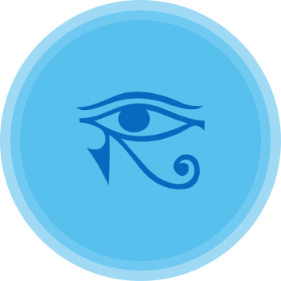
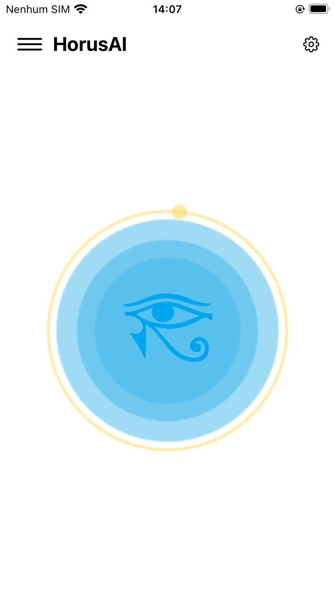
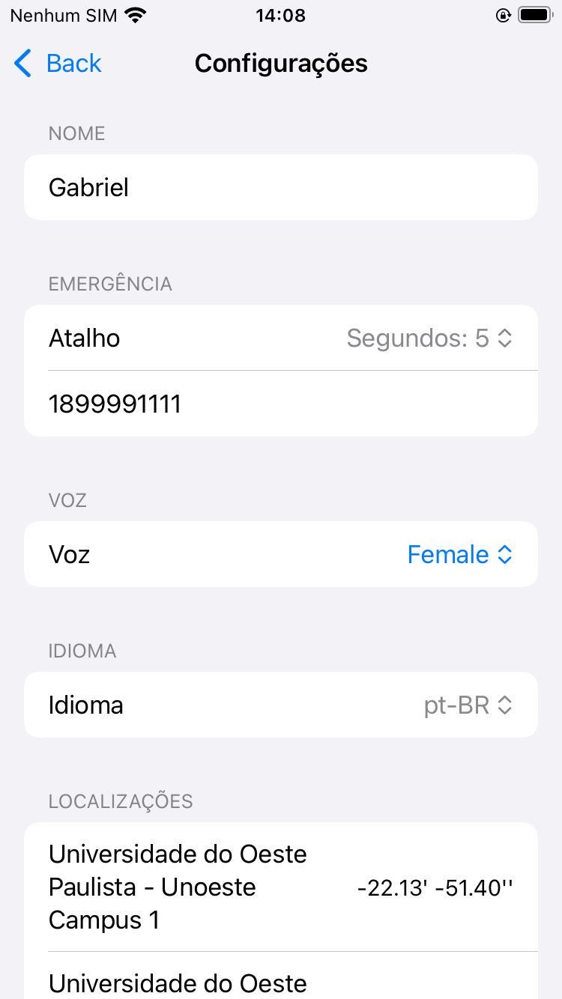
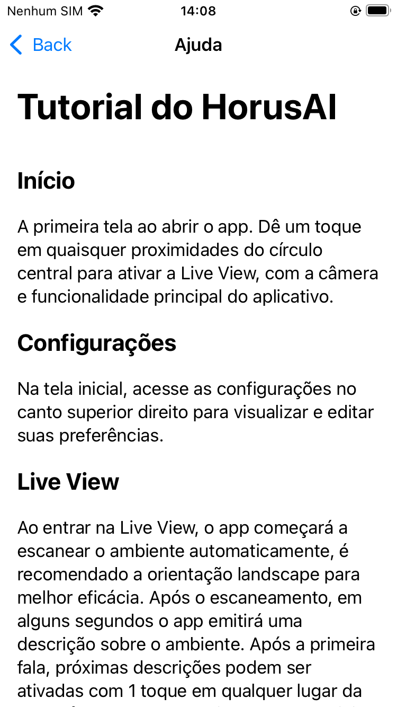
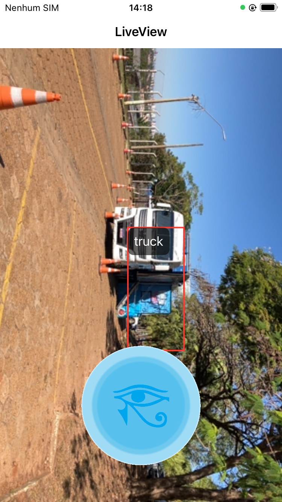

# HorusAI

  

An iOS app designed to help visually impaired people understand their surroundings.

The app concatenates many AI models in a pipeline in order to obtain audible description of the environment.

Pipeline:
- YOLO: Identifies objects in real-time captured by the camera.
- Gemini: Interprets YOLO's data and outputs a text description on how the surronding might be.
- Text2Speech: Uses AI voice to inform the user by using the Gemini generated text. 

*This project was developed during IBM Hackatruck event by me and my group in 2025*

## Screens

**Main screen**

  

**Config screen**

  

**Info screen**

  

**Camera screen**

  

---